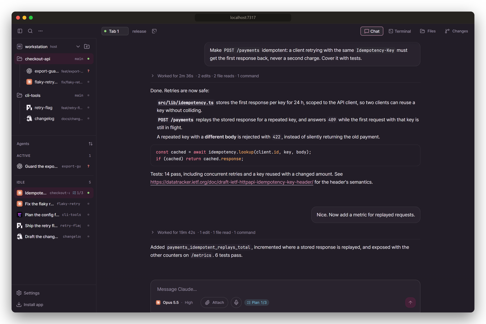

# Orbit

<p align="center">
  
</p>

<p align="center">
  <a href="README.md">English</a> · <a href="README.zh-CN.md">简体中文</a> · <strong>日本語</strong> · <a href="README.ko.md">한국어</a>
</p>

<p align="center">
  <a href="https://github.com/hamzahraihan/orbit">GitHub</a> ·
  <a href="#install">インストール</a> ·
  <a href="docs/guide.md#quick-start">クイックスタート</a> ·
  <a href="#faq">よくある質問</a> ·
  <a href="#docs">ドキュメント</a>
</p>

<p align="center">
  <a href="LICENSE"></a>
  <a href="https://github.com/hamzahraihan/orbit/stargazers"></a>
  <a href="https://github.com/hamzahraihan/orbit/releases/latest"></a>
  <a href="https://github.com/herdrdev/herdr"></a>
  <a href="docs/guide.md#on-your-phone"></a>
</p>

---



<p align="center"><sub>1 つの Claude Code セッションを、herdr のターミナルからブラウザのターミナルとチャットへ、そしてスマートフォンへ。スマートフォンでは新しい worktree をすぐ隣に起動。</sub></p>

**Claude Code と Codex を、スマートフォンから。**

[herdr](https://github.com/herdrdev/herdr) のブラウザ・スマートフォン向けクライアントです。自分のコンピューターで実行中の同じエージェントセッションを、パソコンでもスマートフォンでもチャットで読んで返答できます。必要なときはターミナルも使えます。

**これはフォークです。** Orbit は上流プロジェクトを改変したフォークで、匿名の使用統計、アプリのアップデート確認、サブスクリプションの使用量メーター、Portal リレーを取り除いています。変更点は [NOTICE](NOTICE) に記録しています。

- **チャットとターミナルを、ひとつのペインで** — Claude Code、Codex、omp、omo、gjc、pi の会話履歴と、herdr が識別した OpenCode と Devin CLI のセッションを表示し、ワンクリックでライブターミナルに切り替えられます。エージェントの作業中に次のメッセージを書いておくと次のターンで送られ、Send now ですぐに送ることもできます。[対応エージェント →](docs/guide.md#supported-agents)
- **タップで承認** — 承認リクエスト、質問、計画メニューがカードになり、問いかけがまだ有効か確認してから回答を送信します。
- **対応が必要なときに通知** — すべてのペインの状態をリアルタイムに表示し、アプリを開いているときは通知が上から降りてきます。入力が必要なときや完了したときには、アプリを閉じていてもプッシュ通知が届きます。
- **スマートフォンにインストール** — キーボードの上にキーバー（Esc、Tab、Ctrl、Alt、Shift、Enter、矢印キー）が並ぶ PWA。キーの並べ替えや独自のキー組み合わせの追加は Settings（設定）でできます。Tailscale のアドレスは QR コードで表示されます。[スマートフォンの設定 →](docs/guide.md#on-your-phone)
- **スマートフォンからスクリーンショットを送る** — + ボタンでペインのフォルダーにアップロードしてパスを挿入。Claude が画像を読みます。
- **エージェントが作ったファイルを開く** — ターミナルのパスをクリック、またはチャットのパスをタップすると、その場でファイルが開きます。
- **話して入力** — チャットやターミナルの入力欄に音声で入力できます。韓国語と英語が混ざっても認識し、送信するまで何も送られません。自分の OpenAI API キー、またはブラウザの音声認識を使います。
- **いつもの作業環境をそのままに** — エージェントは herdr が管理し、このアプリはそこに接続します。エージェントを止めずにプラグインを入れ直すだけで更新できます。新しいタブや worktree は行の ⋯ メニューから作れます。[すべての機能 →](docs/guide.md#features)

---

<a id="install"></a>

## インストール

```bash
curl -fsSL https://raw.githubusercontent.com/hamzahraihan/orbit/main/install.sh | sh
```

Linux（x64、arm64）または macOS に対応しています。必要な herdr 0.9.0+、Bun 1.4+、Node 18+ がなければ現在のユーザー向けにインストールし、その後アプリを herdr プラグインとしてインストールします。既存の herdr が 0.9.0 より古い場合は、自分で herdr を更新・再起動してからインストーラーを再実行してください。デフォルトの待ち受けアドレスを使用し、Tailscale が起動している場合、HTTPS の設定に成功すると tailnet 内のアクセス用アドレスと QR コードが表示されます。自分のデバイスはもともとコードなしで入れます。`tailscale serve` がログイン名を伝えるためです。それでも自分のスマートフォンがペアリングを求められるときは、`HERDR_WEB_TAILSCALE_SERVE_ONLY=1` を設定すると、ログインが1つだけの tailnet ならコードなしで入れるようになります。ただし、公開プロキシやトンネルなど別の経路でこのポートに届く場合は設定しないでください（[アクセスと安全性](docs/guide.md#access-and-safety)）。

<p align="center">
Windows x64 では PowerShell で:

```powershell
irm https://raw.githubusercontent.com/hamzahraihan/orbit/main/install.ps1 | iex
```

[Git for Windows](https://git-scm.com/download/win) が必要です。足りない herdr と Bun を現在のユーザー向けにインストールし、同じプラグインをインストールします。Node や WSL は不要です。スマートフォンから使うには herdr で **Phone setup** を開いてください。herdr が Windows でターミナルのアタッチに対応するまで、Windows のターミナルは入力でき、グリッドが固定された[画面ミラー](docs/remote-pcs.md#windows-pcs)になります。

<p align="center">
  
</p>

必要なソフトウェアがすでにそろっている場合は、プラグインだけをインストールできます。

```bash
herdr plugin install hamzahraihan/orbit
```

herdr が起動した状態で **[localhost:7317](http://localhost:7317)** を開きます。ペインを選ぶか、**New workspace（新規ワークスペース）** からエージェントを起動してください。スマートフォンで使う場合は、インストーラーの QR コードを読み取り、アプリをホーム画面に追加します。[クイックスタート →](docs/guide.md#quick-start)

サーバーのデフォルトの待ち受けアドレスは `127.0.0.1` です。別のデバイスからアクセスする場合は、[スマートフォンの設定](docs/guide.md#on-your-phone)と[アクセスと安全性](docs/guide.md#access-and-safety)を参照してください。

<a id="faq"></a>

## よくある質問

**Claude Code や Codex をスマートフォンから使えますか？**

はい。コンピューターの [herdr](https://github.com/herdrdev/herdr) のペインでエージェントを動かすと、このアプリが同じペインをスマートフォンのブラウザに表示します。エージェント自身の会話履歴はチャットとして、承認や質問はタップして答えるカードとして表示され、ライブターミナルにもすぐ切り替えられます。PWA としてホーム画面にインストールでき、エージェントが入力を待つとプッシュ通知が届きます。[スマートフォンの設定 →](docs/guide.md#on-your-phone)

**チャット表示はどのエージェントに対応していますか？**

Claude Code、Codex、omp、omo、gjc、pi は、それぞれのセッションファイルから読み取ります。OpenCode は herdr が報告したセッションを OpenCode 自身のデータベースから読み取ります。2.x の session_v2 にも、ダウングレード後に同じファイルに残る 1.x のテーブルにも対応します。ホーム画面ではライブターミナルを表示します。Devin CLI は `devin --resume <id>` のように herdr や実行中のプロセスがセッションを示すときにチャットになり、単に `devin` で起動した場合はライブターミナルを表示します。それ以外のプログラムはライブターミナルと状態が表示されます。[対応エージェント →](docs/guide.md#supported-agents)

**herdr の TUI の代わりになるものですか？**

いいえ。どちらも同じターミナルに同時に接続するので、ペインは机の上でも、ブラウザでも、スマートフォンでもそのまま動き続けます。止めたり引き渡したりするものはありません。 [TUI とブラウザ →](docs/guide.md#faq)

**Tailscale は必須ですか？**

いいえ。Tailscale、SSH トンネル、VPN、または自分で設定した HTTPS プロキシで PC に接続できます。アプリのインストールとプッシュ通知には HTTPS や localhost などのセキュアなコンテキストが必要ですが、基本的な閲覧は LAN 上の通常の HTTP アドレスでもできます。[ほかの方法 →](docs/guide.md#faq)

**コードや会話が自分のマシンの外に出ることはありますか？**

セッションファイルは各エージェントを実行している PC に残り、その内容は接続したブラウザへ送られます。Orbit には独自のクラウド中継やアカウントサービスはなく、使用統計をどこにも送りません。任意の音声入力は録音を、文章の整形も使う場合はテキストも、設定したプロバイダーへ送ります。リモート PC の設定やプッシュ通知でも外部サービスに接続することがあります。Orbit は上流プロジェクトを改変したフォークです。変更点は [NOTICE](NOTICE) にあります。エージェント自身のモデルへの接続は、そのエージェントの設定によります。[データの送信とアクセス →](docs/guide.md#faq)

**Windows でも動きますか？**

はい。Windows x64 で、WSL なしで動きます。herdr が Windows でターミナルのアタッチに対応するまで、ターミナルは入力ができる固定グリッドの[画面ミラー](docs/remote-pcs.md#windows-pcs)です。

**collie、roamgate、herdr-remote とは何が違いますか？**

これらも herdr をスマートフォンやブラウザから使うためのクライアントです。このアプリはエージェント自身の会話履歴を読むので、ペインはターミナル出力ではなく、作業がターンごとに折りたたまれたチャットになります。ほかの PC はサイドバーから SSH で追加します。トンネルは付属せず、扱うのは herdr だけです。tmux や zellij、差分表示、Telegram、すぐ使えるトンネルが必要なら、ほかのクライアントのほうが向いています。[詳しい比較 →](docs/guide.md#faq)

**Happy、Paseo、CloudCLI UI とは何が違いますか？**

これらのプロジェクトには、エージェントのセッションを開始・管理する独自の仕組みがあります。このアプリは、すでに動いている herdr のペインを表示し、TUI とブラウザで同じターミナルを使い続けられます。herdr を使っていなければ、それらの導入方法と対応エージェントを比較してみてください。[詳しい比較 →](docs/guide.md#faq)

<a id="docs"></a>

## ドキュメント

まずは[ユーザーガイド](docs/guide.md)をご覧ください：[クイックスタート](docs/guide.md#quick-start) · [対応エージェント](docs/guide.md#supported-agents) · [機能](docs/guide.md#features) · [スマートフォン](docs/guide.md#on-your-phone) · [リモート PC](docs/remote-pcs.md) · [アクセスと安全性](docs/guide.md#access-and-safety) · [設定](docs/guide.md#configuration) · [キーボードショートカット](docs/guide.md#keyboard-shortcuts) · [よくある質問](docs/guide.md#faq)。

さらに詳しく：[仕組み](docs/guide.md#how-it-works) · [チャットの会話履歴](docs/chat-mode-audit.md) · [ターミナルのフロー制御](docs/terminal-flow-control.md) · [変更履歴](CHANGELOG.md)。

<a id="thanks"></a>

## 謝辞

[herdr](https://github.com/herdrdev/herdr) を基盤とし、chatmux から着想を得て、[xterm.js](https://xtermjs.org)、[React](https://react.dev)、[Bun](https://bun.sh)、[Lucide](https://lucide.dev) を使用しています。

[@Yoonwoo-Ha](https://github.com/Yoonwoo-Ha) をはじめ、貢献してくださったすべての方に感謝します。

<a id="agent-instructions"></a>

## エージェント向けの手順

アプリのインストールを支援する場合は、[INSTALL.md](INSTALL.md) に従ってください。リポジトリを変更する場合は、[CONTRIBUTING.md](CONTRIBUTING.md)、[レビュールール](.github/REVIEW.md)、[AGENTS.md](AGENTS.md) に従ってください。

<a id="development"></a>

## 開発

```bash
git clone https://github.com/hamzahraihan/orbit.git
cd orbit
bun install

bun run server      # API + WebSocket on :7317
bun run dev         # Vite on :5173; run in a second terminal
```

```bash
bun run typecheck
bun run test:unit   # no herdr needed
bun test           # isolated herdr test session
bun run test:ui    # browser regression checks
```

変更の送り方は [CONTRIBUTING.md](CONTRIBUTING.md)、テスト、メディア素材、リリースについては[開発ドキュメント](docs/development.md)、UI の規約については [DESIGN.md](DESIGN.md) を参照してください。セキュリティの問題は [SECURITY.md](SECURITY.md) の手順で非公開で報告してください。

<a id="license"></a>

## ライセンス

[MIT](LICENSE)。Copyright © 2026 Orbit contributors.
