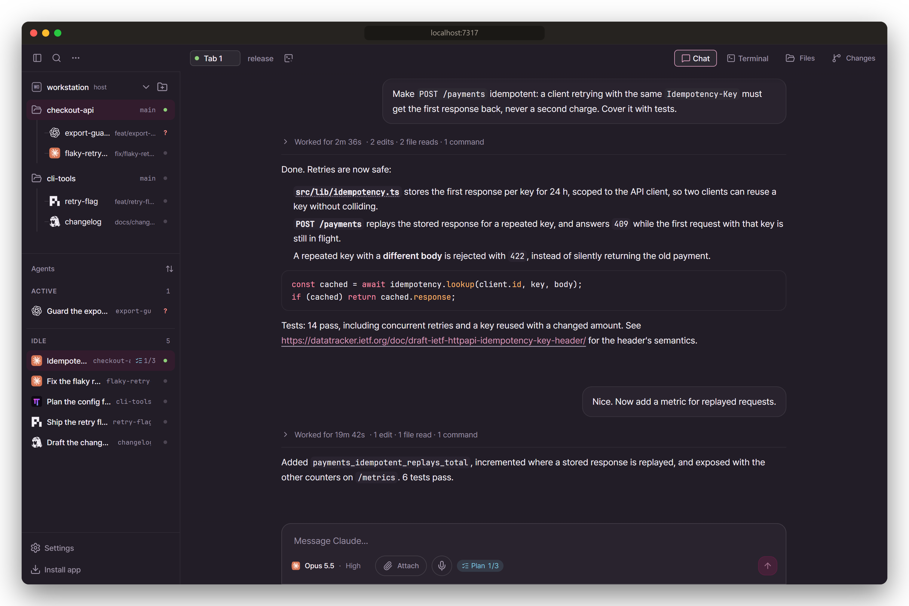

# Orbit

<p align="center">
  
</p>

<p align="center">
  <strong>English</strong> · <a href="README.zh-CN.md">简体中文</a> · <a href="README.ja.md">日本語</a> · <a href="README.ko.md">한국어</a>
</p>

<p align="center">
  <a href="https://github.com/hamzahraihan/orbit">GitHub</a> ·
  <a href="#install">install</a> ·
  <a href="docs/guide.md#quick-start">quick start</a> ·
  <a href="#faq">faq</a> ·
  <a href="#docs">docs</a>
</p>

<p align="center">
  <a href="LICENSE"></a>
  <a href="https://github.com/hamzahraihan/orbit/stargazers"></a>
  <a href="https://github.com/hamzahraihan/orbit/releases/latest"></a>
  <a href="https://github.com/herdrdev/herdr"></a>
  <a href="docs/guide.md#on-your-phone"></a>
</p>

---



<p align="center"><sub>One Claude Code session: in herdr's terminal, then the browser's Terminal and Chat, then the phone, where a new worktree starts beside it.</sub></p>

**Claude Code and Codex, from your phone.**

A browser and phone client for [herdr](https://github.com/herdrdev/herdr). Read and reply to the same agent sessions running on your computer — on desktop or phone, as chat, with the terminal when you need it.

**This is a fork.** Orbit is a modified fork of the upstream project: the anonymous usage counts, the app update checks, the subscription usage meters and the Portal relay are removed. [NOTICE](NOTICE) records the changes.

- **Chat and terminal, one pane** — native Claude Code, Codex, omp, omo, gjc, pi, Hermes and explicitly identified Devin CLI transcripts, plus OpenCode sessions herdr identifies, with the live terminal a click away. Write the next message while the agent works: it goes in with the next turn, or at once with Send now. [Supported agents →](docs/guide.md#supported-agents)
- **Approve with a tap** — approvals, questions and plan menus become cards, checked to be current before your answer is sent.
- **Know when you're needed** — live status for every pane, an alert that drops in while the app is open, and push alerts when an agent needs input or finishes, even with the app closed.
- **Install it on your phone** — a PWA with a key bar above the keyboard (Esc, Tab, Ctrl, Alt, Shift, Enter, arrows) that you can rearrange and extend with your own combinations in Settings, and a QR code to your Tailscale address. [Phone setup →](docs/guide.md#on-your-phone)
- **Send a screenshot from your phone** — the + button uploads it into the pane's folder and adds its path; Claude reads the image.
- **Open what the agent made** — click a path in the terminal, or tap it in the chat, and the file opens right there.
- **Speak instead of typing** — dictate into the chat or the terminal line, Korean and English mixed. Review the words before sending them to the agent; transcription uses your own OpenAI key or the browser's speech recognition.
- **Keep your workflow** — herdr owns the agents; this app connects to them. A new version is a plugin reinstall, and the agents keep running. New tabs and worktrees come from a row's ⋯ menu. [All features →](docs/guide.md#features)

---

## install

```bash
curl -fsSL https://raw.githubusercontent.com/hamzahraihan/orbit/main/install.sh | sh
```

Linux (x64, arm64) or macOS. Installs missing herdr 0.9.0+, Bun 1.4+ and Node 18+ prerequisites for your user, then installs the app as a herdr plugin. If an existing herdr installation is older than 0.9.0, update and restart herdr yourself before rerunning the installer. With the default listen address and Tailscale running, successful HTTPS setup provides a tailnet address and QR code. Your own devices get in without a code as it is: `tailscale serve` states your login. If your own phone is asked to pair anyway, `HERDR_WEB_TAILSCALE_SERVE_ONLY=1` lets it in without a code on a tailnet one login owns, but only when nothing else, such as a public proxy or tunnel, reaches this port ([Access and safety](docs/guide.md#access-and-safety)).

Windows x64, in PowerShell:

```powershell
irm https://raw.githubusercontent.com/hamzahraihan/orbit/main/install.ps1 | iex
```

Requires [Git for Windows](https://git-scm.com/download/win). Installs missing herdr and Bun for your user, then installs the same plugin. No Node or WSL is needed. Open **Phone setup** in herdr for phone access. Windows terminals use the [screen mirror](docs/remote-pcs.md#windows-pcs), with typing and a fixed grid, until herdr supports terminal attach there.

<p align="center">
  
</p>

Already have herdr 0.9.0+, Bun 1.4+ and Node 18+ (Node isn't needed on Windows)? Install just the plugin:

```bash
herdr plugin install hamzahraihan/orbit
```

An older herdr has to be updated and restarted first. [INSTALL.md](INSTALL.md) walks through each step and what to do when one fails.

With herdr running, open **[127.0.0.1:7317](http://127.0.0.1:7317)**. On a new install on a PC with a desktop, the installer opens it in your browser for you; click **Install** in the address bar to add the app. The installed app belongs to that exact address, so keep using `http://127.0.0.1:7317` rather than `localhost`. Set `HERDR_WEB_NO_OPEN=1` before running the installer to skip opening the browser. Pick a pane or start an agent with **New workspace**. To use your phone, scan the installer's QR code and add the app to your home screen. [Quick start →](docs/guide.md#quick-start)

The server listens on `127.0.0.1` by default. For access from another device, see [phone setup](docs/guide.md#on-your-phone) and [access and safety](docs/guide.md#access-and-safety).

## faq

**Can I use Claude Code or Codex from my phone?**

Yes. Run the agent in a [herdr](https://github.com/herdrdev/herdr) pane on your computer, and this app shows the same pane in your phone's browser: the agent's own transcript as a chat, its approvals and questions as cards you tap, and the live terminal a tap away. It installs to the home screen as a PWA and sends a push alert when an agent needs you. [Phone setup →](docs/guide.md#on-your-phone)

**Which agents does the chat view support?**

Claude Code, Codex, omp, omo, gjc, pi and Hermes are read from their own session stores. For OpenCode, the chat reads the session herdr reports from OpenCode's database — OpenCode 2's `session_v2`, or the 1.x tables a downgrade keeps in the same file; the home screen uses the live terminal instead. Devin CLI is a chat when herdr or the running process names its session, as `devin --resume <id>` does; a plain `devin` shows the live terminal. Any other program in a herdr pane gets the live terminal and its status. [Supported agents →](docs/guide.md#supported-agents)

**Does it replace herdr's own TUI?**

No. Both attach to the same terminals at the same time, so the pane stays live at your desk, in the browser and on the phone. Nothing is stopped or handed over. [TUI and browser →](docs/guide.md#faq)

**Do I need Tailscale?**

No. Tailscale, an SSH tunnel, a VPN or your own HTTPS proxy can provide a route to the PC. Installation and push alerts need a secure context such as HTTPS or localhost; basic browsing also works over plain HTTP on a LAN. [The options →](docs/guide.md#faq)

**Does my code or conversation leave my machine?**

Session files stay on the PC running each agent, and their contents are served to browsers you connect. Orbit has no hosted relay or account service of its own and sends no usage counts anywhere. Optional voice input sends audio (and text when polishing) to the configured provider. Remote-PC setup and push alerts can also use external services. Orbit is a modified fork of the upstream project: [NOTICE](NOTICE) lists what changed. The agents’ own model connections depend on their configuration. [Data flow and access →](docs/guide.md#faq)

**Does it work on Windows?**

Yes, on Windows x64 without WSL. Until herdr can attach a terminal there, the terminal is a [screen mirror](docs/remote-pcs.md#windows-pcs) with typing and a fixed grid.

**How is it different from collie, roamgate or herdr-remote?**

These are other phone or browser clients for herdr. This one reads the agent's own transcript, so a pane is a chat with the work folded per turn rather than terminal output, and other PCs join over SSH from the sidebar. It brings no tunnel and drives only herdr: if you want tmux or zellij, diffs, Telegram or a tunnel out of the box, one of the others is the better fit. [The full comparison →](docs/guide.md#faq)

**How is it different from Happy, Paseo or CloudCLI UI?**

Those projects provide their own ways to start or manage agent sessions. This app works with the herdr panes you already run, keeping the same terminals available in the TUI and browser. If you do not use herdr, compare those projects’ deployment options and agent support. [The full comparison →](docs/guide.md#faq)

## docs

Start with the [user guide](docs/guide.md): [quick start](docs/guide.md#quick-start) · [supported agents](docs/guide.md#supported-agents) · [features](docs/guide.md#features) · [phone](docs/guide.md#on-your-phone) · [remote PCs](docs/remote-pcs.md) · [access and safety](docs/guide.md#access-and-safety) · [configuration](docs/guide.md#configuration) · [keyboard shortcuts](docs/guide.md#keyboard-shortcuts) · [FAQ](docs/guide.md#faq).

For a closer look: [how it works](docs/guide.md#how-it-works) · [chat transcripts](docs/chat-mode-audit.md) · [terminal flow control](docs/terminal-flow-control.md) · [changelog](CHANGELOG.md).

## thanks

Built on [herdr](https://github.com/herdrdev/herdr), with inspiration from chatmux, and powered by [xterm.js](https://xtermjs.org), [React](https://react.dev), [Bun](https://bun.sh) and [Lucide](https://lucide.dev).

Thanks to everyone who has contributed, including [@Yoonwoo-Ha](https://github.com/Yoonwoo-Ha).

## agent instructions

Helping someone install the app? Follow [INSTALL.md](INSTALL.md). For repository changes, follow [CONTRIBUTING.md](CONTRIBUTING.md), the [review rules](.github/REVIEW.md) and [AGENTS.md](AGENTS.md).

## development

```bash
git clone https://github.com/hamzahraihan/orbit.git
cd orbit
bun install

bun run dev         # Vite on :5173, starting the API on :7317 when that port is free
bun run server      # API + WebSocket alone on :7317; `bun run dev` restarts the API on server/ or shared/ changes
```

```bash
bun run typecheck
bun run test:unit   # no herdr needed
bun test           # isolated herdr test session
bun run test:ui    # browser regression checks
```

See [CONTRIBUTING.md](CONTRIBUTING.md) to send a change, [development](docs/development.md) for tests, media and releases, and [DESIGN.md](DESIGN.md) for UI conventions. Report security problems privately: [SECURITY.md](SECURITY.md).

## license

[MIT](LICENSE). Copyright © 2026 Orbit contributors.
